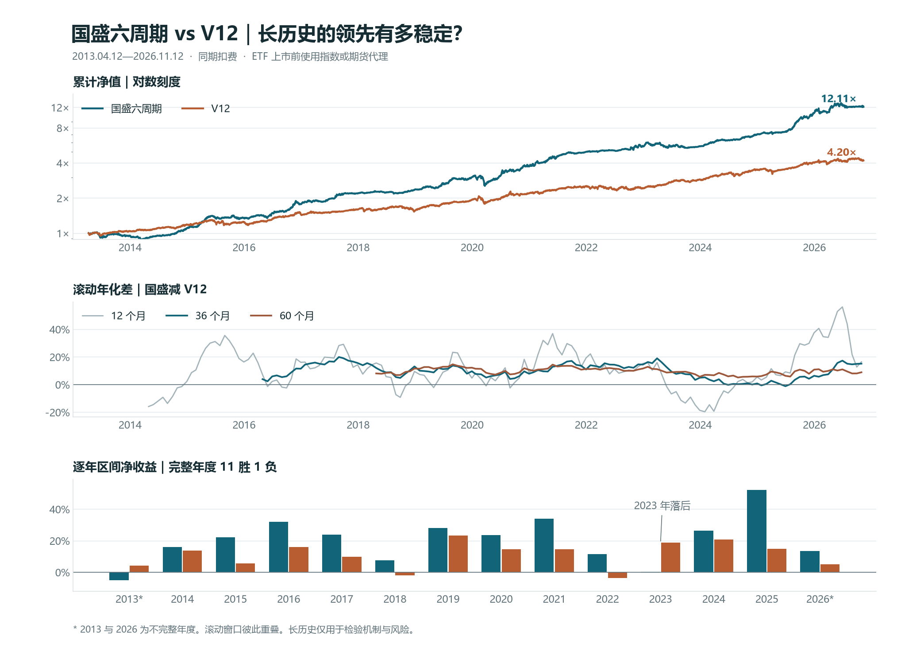
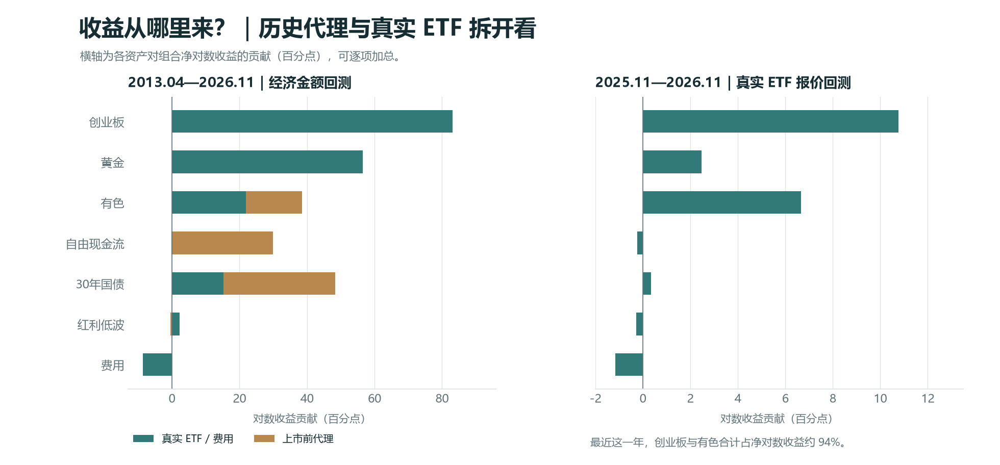

# 国盛六周期 ETF：长历史、收益归因与 V12 对照

截至 2026-11-12。结论：**有值得继续观察的周期换仓机制，但目前不够资格替代 V12。** 2013-04-12 起的经济回测年化高 9.01 个百分点，波动高 2.11 个百分点，最大回撤深 4.57 个百分点。把未上市部分改留现金后，年化优势只剩 2.76 个百分点；本地能复核的较晚公开映射之后，按真实 ETF 报价另起账户，国盛累计 −3.49%，V12 −0.68%，国盛波动和回撤也更高。

## 规则、起点和证据边界

六只为创业板 159915、黄金 518880、有色期货 159980、自由现金流 159201、30 年国债 511090、红利低波 100 515100。月初按上一交易日可用信息判阶段，在阶段对应的 2–3 只中做 63 日等风险贡献配置。第 5、6 阶段资产相同，所以实际有五种篮子。组合不加杠杆，也不做组合总波动目标。沿用前一轮冻结的本地重建：货币以 DR007/SHIBOR 和四项可取得的政策工具近似，未还原报告的 24 项；信用使用央行月报的两部门中长期贷款；增长取三条 PMI 的多数票。来源：[2025 年原研报](https://www.sdyanbao.com/detail/933398)、[2024 年指标方法，第 5–6 页](https://aigc.idigital.com.cn/djyanbao/%E3%80%90%E5%9B%BD%E7%9B%9B%E8%AF%81%E5%88%B8%E3%80%912024%E5%B9%B4%E5%BA%A6%E9%87%91%E8%9E%8D%E5%B7%A5%E7%A8%8B%E4%B8%AD%E6%9C%9F%E7%AD%96%E7%95%A5%E5%B1%95%E6%9C%9B-2024-07-14.pdf)、[2026-05-06 作者的后续公开说明](https://finance.sina.com.cn/wm/2026-05-06/doc-inhwxhnn8400327.shtml)。这里的数字是本地重建结果。

- 宏观已接至 2010 年。央行逐月保留发布日期，年内累计扣除已报告月份；2011 年 5 月用[央行公告附件](https://www.pbc.gov.cn/eportal/fileDir/image_public/UserFiles/goutongjiaoliu/upload/File/2011%E5%B9%B45%E6%9C%88%E9%87%91%E8%9E%8D%E7%BB%9F%E8%AE%A1%E6%95%B0%E6%8D%AE%E6%8A%A5%E5%91%8A%281%29.pdf)。早期私人 PMI 从汇丰终值历史补齐，抽查[财新当年报道](https://economy.caixin.com/2011-04-29/100254184.html)和[2011 年 9 月发布](https://finance.sina.com.cn/china/hgjj/20110930/121810570800.shtml)。老非制造业 PMI 用当年公布口径的历史汇表，抽查[中物联 2011 年 10 月](https://old.chinawuliu.com.cn/lhhkx/201111/03/174055.shtml)和[11 月](https://old.chinawuliu.com.cn/lhhkx/201112/03/175480.shtml)；另跑 Tushare 历史值。宏观发布时间精度为日，并非每个历史时点的完整存档。
- 六资产价格共同起于 2013-01-04 的收益，满 63 个过去交易日后 2013-04-12 才可统一启动。自由现金流基日是 2012-12-31；在保留同一资产和风险窗口的条件下，不能用这套数据再往前连续回测。2013-05-02 自然月初另跑，年化 20.43% 对 11.30%，起始日不是主要驱动。V12 用已审核的早期输入补 2014-01-16 前，接点后 1,466 个重合交易日逐值相符。V12 的旧外盘代理按中国日期只使用已结束的美股时段。
- 2013–2025 的金额账本仍有上市前腿：有色是逐合约期货收益，黄金早期用上金所现货，现金流是国证价格指数，红利用全收益指数，30 年债用中债财富指数。**现金流前身 CN6008 是海南综合指数；现行规则 2024-08-15 才生效。** 2013 起的 980092 历史不能当作当时可直接观察并投资的现金流指数。[2012 年原发布公告](https://www.cnindex.com.cn/zh_information/notices_news/2012/201301/P020191213350554121312.pdf)、[2024 年编制修订公告](https://www.cnindex.com.cn/zh_information/notices_news/2024y/202408/P020240809382160400833.pdf)、[159201 上市公告](https://www.szse.cn/disclosure/notice/fund/t20250224_611985.html)。
- 2025-06-04 起六只均有 63 日真实历史，可独立跑真实报价回测：两策略均初始 100 万元、单边 9bp 滑点和万 1.5 佣金（最低 5 元）。金额模型用次收盘按金额成交；真实 ETF 模型用次开盘，按原价和 100 股整手买入，卖出所得次日才用于补买，检查涨跌停、成交及过去 20 日平均量的 1%。这里没有使用真实成交单。已核对 6 只 × 248 日 QMT 与 Tushare 未复权开收盘；本轮使用已存档的交叉核对和行情快照。

## 同期收益与稳定性

表中三项按 **净年化 / 年化日波动 / 最大回撤**，均为百分比。冷启动均从 100 万元；子区间沿用父账户仓位并重算该段内回撤。短区间直接比较累计收益。

| 共同区间 | 模型 | 国盛 | V12 |
|---|---|---:|---:|
| 2013-04-12 至今 | 经济金额 | 20.15 / 11.78 / 18.64 | 11.13 / 9.67 / 14.07 |
| 2014-01-02 至今 | 经济金额 | 21.85 / 11.76 / 18.64 | 11.42 / 9.76 / 14.07 |
| 2016-01-04 至今 | 经济金额 | 22.50 / 12.07 / 18.64 | 11.94 / 9.91 / 14.04 |
| 2020-01-02 至今 | 经济金额 | 22.23 / 13.45 / 18.65 | 11.90 / 10.84 / 14.01 |
| 2025-06-04 至今 | 真实 ETF | 37.49 / 17.47 / 8.89 | 13.50 / 10.87 / 8.20 |
| 2025-11-06 至今 | 真实 ETF，247 日 | 19.99 / 18.69 / 8.91 | 6.26 / 12.25 / 8.22 |
| 2026-05-07 至今 | 真实 ETF，独立冷启动；首项为累计 | −3.49 / 16.28 / 8.88 | −0.68 / 11.38 / 6.27 |

| 长账本分段 | 国盛：收益 / 波动 / 回撤 | V12：收益 / 波动 / 回撤 |
|---|---:|---:|
| 2013-04-12—12-31（累计） | −5.15 / 12.10 / 10.59 | +4.02 / 8.03 / 6.40 |
| 2014—2016（年化） | 23.14 / 10.59 / 7.75 | 11.71 / 8.79 / 9.95 |
| 2017—2019（年化） | 19.45 / 8.23 / 5.07 | 9.88 / 7.91 / 10.39 |
| 2020—2022（年化） | 22.56 / 14.28 / 18.64 | 8.13 / 11.65 / 14.07 |
| 2023—2025（年化） | 24.36 / 10.04 / 10.58 | 18.04 / 9.38 / 10.21 |
| 2026 至 11-12（累计） | +13.33 / 19.61 / 9.74 | +4.91 / 12.59 / 8.26 |

- 完整年份 11/12 领先；最差相对年是 2023 年：+0.11% 对 +18.70%。最强 2025 年：+52.29% 对 +14.83%。疫情压力段（2020-02-03 到 03-31）国盛 −13.56%、V12 −6.53%；国盛长样本最大回撤低点为 2020-03-23。相反，2018 整年国盛 +7.50% 对 −1.91%，2022 国盛 +11.41% 对 −3.75%，当时防守篮子在一部分股票下跌阶段有效。
- 月末滚动 12 / 36 / 60 个月，领先 119/151、123/127、103/103。最弱的 12 个月为 2023-02-01—2024-01-31，国盛 −3.19% 对 V12 +16.53%，差 −19.72 个百分点；最弱三年差 −1.23 个百分点；样本内最弱五年仍领先 5.08 个百分点。窗口彼此重叠。去掉任一个完整年，剩余完整年的年化**相对净值倍数增长**约 7.47%–11.98%，这也只是回顾性检查。
- 真实 ETF 的 2025-11-06—2026-11-12 账户，按连续持仓划开：2025 年余下 +8.35% 对 +1.60%，2026 年 1–4 月 +12.64% 对 +3.98%，5 月起 −1.35% 对 +0.70%。5 月 7 日另外冷启动的结果也落后；国盛零滑点、仍扣佣金为 −3.07%，交易费不是这次落后的主要原因。

## 钱从哪来，离开好行情还剩多少

将各标的逐日盈亏、费用都除以上一日净值，得到加和等于当日净收益的分项。再按同一比例 log(1+r)/r 分摊当日对数收益，能准确汇总到跨期复利；“贡献占比”是净对数收益分项，不是删掉该标的后差多少。真实 ETF 以开盘前后实际持仓算盈亏。

| 资产 | 长账本净对数收益占比 | 2025-11-06 后真实 ETF 占比 |
|---|---:|---:|
| 创业板 | 33.3% | 58.0% |
| 黄金 | 22.7% | 13.3% |
| 有色 | 15.5% | 35.8% |
| 自由现金流 | 11.9% | −1.3% |
| 30 年国债 | 19.4% | 1.9% |
| 红利低波 100 | 0.8% | −1.5% |
| 费用 | −3.5% | −6.3% |

长账本创业板与黄金合计 56.0%；国债与有色也有贡献。约 31.8% 净对数收益来自未上市的代理腿，自由现金流累计贡献几乎全来自代理段。V12 也有集中：长账本纳指与标普的净对数收益合计约 59.7%，故它在美国股票强而本地成长、有色偏弱时有相对优势。

| 同期压力试验 | 国盛净年化 | 同处理的 V12 净年化 | 含义 |
|---|---:|---:|---|
| 双方同时删掉最高超额的 2025 年 | 16.49% | 10.01% | 该年占总净超额对数 26.6% |
| 双方同时删掉超额最高的三个整年（2025/2021/2022） | 13.11% | 9.21% | 三年合计 55.0%，其余仍领先 |
| 双方同时删掉国盛最好的 1% 交易日（33 日） | 12.48% | 8.18% | 这些日贡献国盛净对数 35.9%、相对净超额 50.0% |
| 双方同时删掉超额最好的 1% 交易日 | 16.23% | 13.88% | 策略还领先，优势明显缩窄 |
| 长期同时把创业板与黄金的目标份额置现金 | 8.84% | 11.13% | 两条腿共同重要；把任一条单独置现金仍领先 |
| 自由现金流在 2024-08-15 前置现金 | 17.69% | 11.13% | 单独压制规则回填风险，优势尚存 |
| 所有上市前 ETF 目标份额置现金 | 13.90% | 11.13% | 波动 10.30% 对 9.67%，回撤 18.64% 对 14.07% |
| 真实期将创业板或有色各自置现金 | 11.15% / 14.76% | 6.26% | 任何一只缺失都会缩小优势 |
| 真实期将创业板、有色同时置现金 | 3.87% | 6.26% | 两只原本共贡献约 93.9% 的净对数收益 |
| 真实期双方同时删掉相对收益最高的三个月 | 12.28% | 14.95% | 近一年超额对少数月份特别敏感 |

删日/删月/删年是对双方既有收益路径同日置零，按原时长年化，属于事后集中度诊断；删资产是用原规则重跑，将对应权重留现金，未把它分给其他资产。上市前留现金仍以原代理估风险，只是检验代理腿实际赚钱多少，不是一个新可部署策略。

按标的同期涨跌分组（只用完整月份，标签在事后才知道）：创业板和有色同涨 49 个月，国盛平均月超额对数 **+2.27 个百分点**，贡献超过全体完整月净超额的 100%，因为其他状态有抵消；双跌 41 个月，平均 **−0.40 个百分点**。单涨单跌两组平均仅约 +0.11 至 +0.16 个百分点。阶段 2 也有正反两面：2015 年 3–6 月该篮子 +23.35% 对 +5.44%，2023 年 4–10 月同一篮子 −8.32% 对 +7.66%。历史共有 52 段连续篮子，34 段相对为正，最佳三段约贡献 44.5% 的净超额。

## 数学结构与经济解释

| 阶段 | 货币 / 信用 / 增长方向 | 持仓 | 可检验的经济解释与边界 |
|---|---|---|---|
| 1 | + / + / − | 创业板、黄金 | 流动性转松有利于成长估值，黄金可缓冲增长还弱时的风险；金价也受美元、实际利率及汇率影响 |
| 2 | + / + / + | 创业板、有色 | 融资和需求一起改善时，成长估值及工业品可能同涨；如果信用去了别处或需求落空，两只也能一起跌 |
| 3 | − / + / + | 现金流、有色 | 货币转紧后，有现金创造能力的公司相对不依赖外部融资，实体需求仍可支持有色；现金流指数同时有估值、行业暴露 |
| 4 | − / − / + | 现金流、有色、30 年债 | 在增长尚可时保留实体敞口，同时为放缓配债；若通胀导致收益率上升，长债也会亏 |
| 5 | − / − / − | 红利低波、30 年债、黄金 | 增长承压时少配高弹性资产；风险分散依赖相关性与债券、黄金的现实驱动 |
| 6 | + / − / − | 红利低波、30 年债、黄金 | 政策转松未必已传到贷款与盈利；本版与阶段 5 同篮子 |

三个符号表达变化方向：信用是两部门新增中长贷合计的滚动 12 月同比，再比较三个月的变化；增长对三条 PMI 的滚动均值做类似计算再投票。它不是“PMI 大于 50 就买股票”。历史约 16.8% 的交易日信号组合不落入六格，沿用上一个阶段，因此同一个当日符号组合不总对应同一个仓位。货币、信用和 PMI 互相影响，政策会逆周期，三票也并非三项独立信息。

风险层令每只资产的方差贡献 wᵢ(Σw)ᵢ 等分。两只多头时，等式两边的协方差交叉项抵消，得到 w₁σ₁ = w₂σ₂，因此权重与过去波动率成反比。有三只时，相关性才直接改变权重。即便两只的权重不变，令两者各自加权波动为 q，则组合方差是 2q²(1+ρ)；危机里相关性上升，会直接放大组合风险。长账本 164 次目标的事前年化波动约 **2.57%–25.13%**，所以等风险只管篮子内部。30 年国债还带久期风险，收益率上升时约按久期放大价格下跌。[等风险贡献原论文](https://papers.ssrn.com/sol3/papers.cfm?abstract_id=1271972)、[30 年国债 ETF 标的说明](https://www.sse.com.cn/disclosure/fund/announcement/c/new/2023-02-14/511090_20230214_7A0R.pdf)。

用金额模型做逐日精确拆分：平均毛收益 = 各资产的平均权重 × 平均收益之和 + 权重与当日资产收益的协方差之和。把协方差再拆成“有无进篮子”和“篮子内权重及漂移”两块。按日均值乘 252，国盛 **静态敞口 9.42% + 进篮子 9.74% + 权重与漂移 1.24% − 费用 0.66% = 19.74%**；V12 约 **11.81% − 0.29% − 0.09% = 11.42%**。这些是样本内算术年化分解，与复合年化 20.15% 和 11.13% 是两种口径；协方差不是因果收益。

| 固定对照 | 长样本净年化 | 长样本波动 | 真实 ETF 后段净年化（2025-11-06 起） |
|---|---:|---:|---:|
| 本地原规则 | 20.15% | 11.78% | 19.99% |
| 同六资产静态 ERC | 9.41% | 6.39% | 3.35% |
| 阶段信号慢一个月，风险预算照常更新 | 14.12% | 11.78% | 4.86% |
| 阶段信号慢三个月，风险预算照常更新 | 11.70% | 11.95% | −4.39% |
| 循环错配四种原篮子映射 | 0.37%–12.06% | 11.74%–13.20% | −8.22%–8.41% |
| 信用与 PMI 发布时间各推迟 7 个自然日 | 20.47% | 11.79% | 23.73% |
| 货币只用市场利率方向 | 20.65% | 11.72% | 19.99% |
| 早期采用 Tushare 非制造业 PMI 版本 | 20.58% | 11.89% | 不适用 |

证据更新：同池静态明显更弱，且一个月延迟的波动几乎相同却少了约 6 个点年化，原映射强于所有四个固定错配。这支持“什么时候拿哪个篮子”在这段历史里有价值。资产收益与信号同时受同一经济环境驱动，不能由此断言宏观指标有稳定因果预测力；四项政策工具也没有显示独立增益。上市前腿、股与商品同涨时段、近一年头部 ETF 都解释了相当一部分结果，而可核对的较晚公开窗口已经落后。当前证据足以保留机制研究；远不足以给一个未来跑赢概率或把 20% 当收益预期。

## 文件与复核入口

- [回测起点与全部对照](tables/replays.csv)、[分段](tables/blocks.csv)、[逐年](tables/years.csv)、[滚动窗口](tables/rolling_windows.csv)、[极端区间](tables/stress.csv)、[真实 ETF 分段](tables/actual_slices.csv)。
- [标的与时间归因](tables/asset_attribution.csv)、[同日去头部](tables/concentration.csv)、[敞口和择时分解](tables/timing_attribution.csv)、[阶段段落](tables/phase_episodes.csv)、[未上市腿压力](tables/proxy_stress.csv)、[成本衰减](tables/cost_curve.csv)。
- [22 条审计](过拟合审计.md)、[数据覆盖](coverage.json)、[校验证据](audit_checks.json)、[快照指纹](input_hashes.json)、[复跑脚本](reproduce.ps1)。在本目录执行 PowerShell 的 reproduce.ps1，需保留同级的原国盛回测和 V12 数据目录；已有快照可直接复用。带 -VerifyOnly 复核冻结规则、账本和数据。
- 工具取舍：现有 pandas/Parquet、逐日账本和固定规则够用。没有为这次审计引入调参框架或重选更好的资产。
